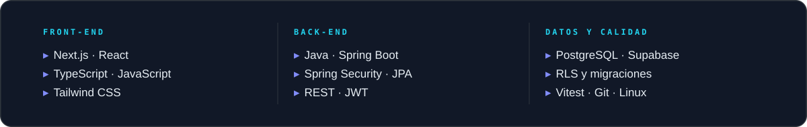
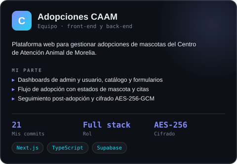
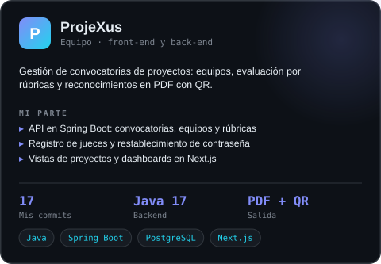
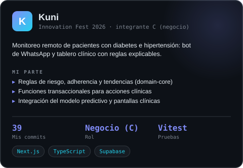
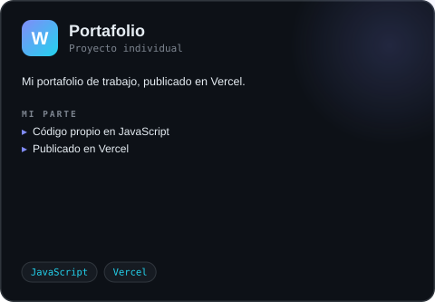

<a href="https://portafolio-six-neon-39.vercel.app/">
  <picture><source media="(prefers-color-scheme: dark)" srcset="assets/banner-dark.svg"><source media="(prefers-color-scheme: light)" srcset="assets/banner-light.svg"></picture>
</a>

 

  <strong>Desarrollador full stack en formación: interfaces, APIs y bases de datos.</strong> 
  Último año de Ingeniería en Sistemas Computacionales · México

<a href="https://portafolio-six-neon-39.vercel.app/">
  <picture><source media="(prefers-color-scheme: dark)" srcset="assets/overview-dark.svg"><source media="(prefers-color-scheme: light)" srcset="assets/overview-light.svg"></picture>
</a>

<h3>Proyectos destacados</h3>

Trabajo en equipo: en cada tarjeta indico qué parte desarrollé yo.

<a href="https://github.com/TonyMed12/Adopciones-CAAM"><picture><source media="(prefers-color-scheme: dark)" srcset="assets/project-caam-dark.svg"><source media="(prefers-color-scheme: light)" srcset="assets/project-caam-light.svg"></picture></a>
<a href="https://github.com/TonyMed12/ProjeXus"><picture><source media="(prefers-color-scheme: dark)" srcset="assets/project-projexus-dark.svg"><source media="(prefers-color-scheme: light)" srcset="assets/project-projexus-light.svg"></picture></a>
 
<a href="https://github.com/EnrMar17/Kuni"><picture><source media="(prefers-color-scheme: dark)" srcset="assets/project-kuni-dark.svg"><source media="(prefers-color-scheme: light)" srcset="assets/project-kuni-light.svg"></picture></a>
<a href="https://portafolio-six-neon-39.vercel.app/"><picture><source media="(prefers-color-scheme: dark)" srcset="assets/project-portafolio-dark.svg"><source media="(prefers-color-scheme: light)" srcset="assets/project-portafolio-light.svg"></picture></a>

<h3>Actividad en GitHub</h3>

<h3>Contribuciones</h3>

<picture><source media="(prefers-color-scheme: dark)" srcset="https://raw.githubusercontent.com/Rudy-77/Rudy-77/output/snake-dark.svg"><source media="(prefers-color-scheme: light)" srcset="https://raw.githubusercontent.com/Rudy-77/Rudy-77/output/snake-light.svg"></picture>

